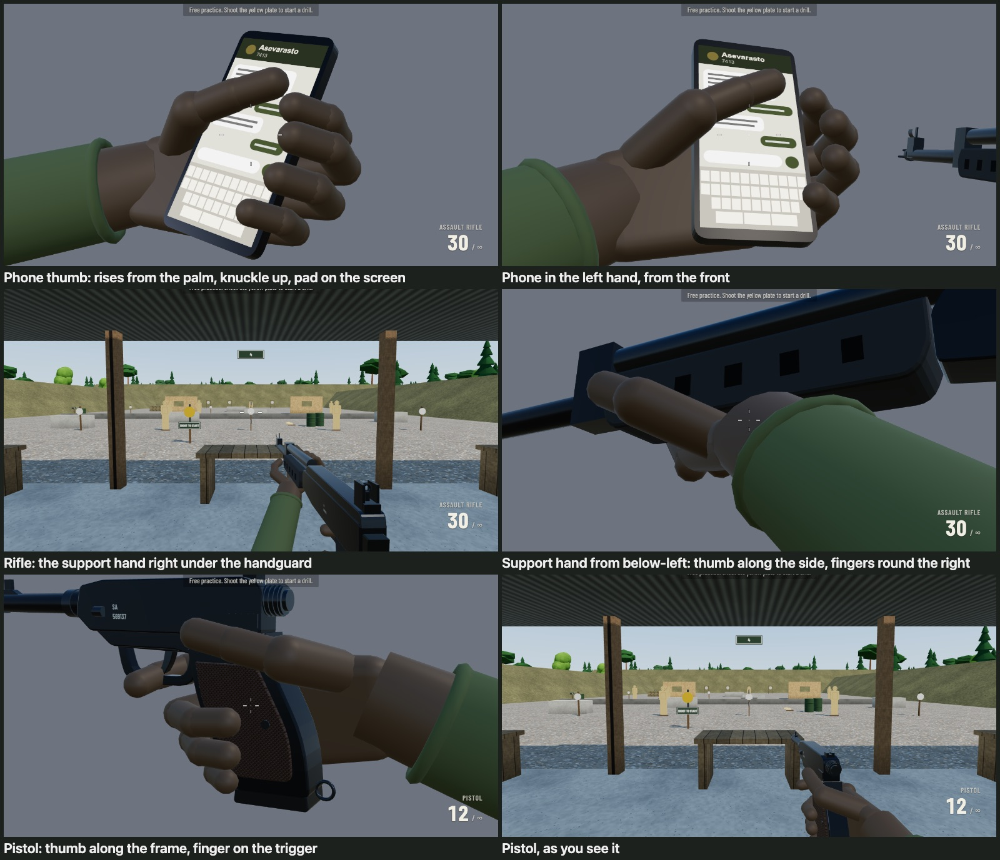

# MULTI-PASKER 2

A browser FPS for one LAN party: up to 16 players, each on a computer for combat and on their
own phone for weapon support from a gruff Finnish army armourer, the *varusmestari*.
The interface is in English; voice lines, range commands and the varusmestari's dialogue are
Finnish. The full brief is in [docs/BRIEF.md](docs/BRIEF.md) and the technology choices are in
[docs/STACK.md](docs/STACK.md).

> **Status:** all seven milestones are in: the shooting range, LAN free-for-all matches on the
> garrison map with bots, the phone (pairing, the messaging app with its own keyboard, the
> varusmestari), the service from TJ 347 to 0 with the päiväraha, P-kausi's gear by text and the
> Sotku App's four upgrade paths, end-of-round awards and the evening scoreboard. Not yet tried on real phones: see [docs/CHECKPOINT-B.md](docs/CHECKPOINT-B.md) for
> the real-device test and [docs/VALIDATION.md](docs/VALIDATION.md) for what was tested.

## Requirements

- **Host machine:** macOS or Windows with [Node.js](https://nodejs.org/) 22.12 or newer (24 LTS recommended).
- **Players:** a desktop browser, Chrome or Edge (Firefox best effort), and a phone (iPhone Safari or
  Android Chrome), all on the same network as the host. No app to install.
- Everything is bundled: nothing is loaded from the internet while playing.

## Install and start

```bash
npm install
```

```bash
npm start
```

`npm start` builds the client and starts the server on port 8088. It prints the address
players should open, for example:

```
 Players: open  http://192.168.1.23:8088/  in Chrome or Edge
```

On the host machine itself you can also use `http://localhost:8088/`.

Other commands:

| Command | What it does |
|---|---|
| `npm run dev` | Development server with hot reload (same port, same LAN address) |
| `npm test` | Unit tests (collision, movement, weapons, range, grenades, map, match server, bots) |
| `npm run typecheck` | TypeScript type check |
| `npm run build:web` | Build the web version (range and bot match, no server) into `dist-web/` |
| `npm run preview:web` | Serve the web build at http://localhost:8100/ |
| `npm run deploy:web` | Type check, test, build and deploy the web version (asks before changing anything) |
| `npm run gen:sfx` | Re-synthesise footsteps, impacts, hit markers, grenade sounds |
| `npm run gen:voice` | Re-make placeholder voice lines and `docs/RECORDING.md` |

### Choosing the address and port

The server picks the host's Wi-Fi/Ethernet address and ignores VPN, WSL, Docker, VirtualBox
and VMware adapters. If it picks the wrong one (it also lists the alternatives), override it:

```bash
npm start -- --host 192.168.1.23 --port 8088
```

or set the environment variables `PASKER_HOST` and `PASKER_PORT`.

## Playing a match

One person hosts: `npm start` on their computer makes it the server (no internet or cloud
service involved), and they can play on the same machine.

1. Start the server on one machine (`npm start`) and have everyone open the printed address.
2. **Join game**, type a name (letters including Å, Ä, Ö and digits, up to 12) and click the view.
   The first time, you start on the shooting range for a short training (see below); after that,
   joining goes straight to the match.
3. Free-for-all on the garrison (*varuskunta*): 4-minute rounds of free fighting, respawn after
   3 s, a short spawn protection that ends when you fire. Tab shows the scoreboard; it also appears between
   rounds, and the next round starts by itself after 12 s.
4. The garrison: the kasarmi (barracks) to the north, the asevarasto (armoury) to the east, the
   sotku (canteen) to the west, the esterata (obstacle course) to the south, and the **Veksi**,
   the garrison sick bay, in the south-east corner: a waiting room with the reception counter, a
   corridor and a ward of beds, with doors to the street, the parade ground and the yard.
5. With more than 8 players the two gates (*puomi*) open the outer ring, a tent camp you can loop
   through by the road gate and the back gate. Bots use the gates too, once they are open.

Reloading the page puts you back into the same player (score kept). Leaving from the Esc menu
shows you as *left* to the others; you can come back during the round.

**The minimap** (top left) is the garrison from above, turned so that where you look is up, with
north marked on its rim. An enemy who fires without a suppressor shows as a red dot where the shot
came from for 2.5 s (on the rim when further away), and the closed gate is a red bar. Its range
and timing are `MINIMAP` in `config.ts`; Settings → *Show the minimap* turns it off.

**Bots** fill empty slots for testing: F2 → *Add bot* / *Fill with bots (15)*, or start the server
with `PASKER_BOTS=15 npm start` (`set PASKER_BOTS=15` first on Windows).

### The training

Everyone's first join starts on the range, not in the match (the scoreboard shows them as *on
the range*): walk to the marked table, knock down the marked target, press R and find there is
no spare magazine, then pick up the phone from the duty table behind you (E). That opens the
pairing screen, which explains that the phone app is only a web page from the host's computer
(nothing to install, no permissions, it connects only to the host computer). Asevarasto's first
text is a radio check (*yhteyskoe*), just `YK`: reply `YK` and the magazines are full (anything
else gets the explanation, and after that less patience). Train as long as you like, then Esc → **Go to the match**.
The browser remembers that you've done it.

**Without a phone of your own:** the pairing panel (on the training's pairing screen and in the
Esc menu) has **Open a virtual phone**: the same phone app on your screen, typed on by clicking
its keys with the mouse (the keyboard does nothing). Your character has the phone out while it
is open and the game waits for you, so it is much slower and clumsier than a real phone; *Back
to the game* or Esc puts it away. Phones never use Bluetooth or a cable: the phone page connects
over Wi-Fi to the computer hosting the game, so the phones' Wi-Fi has to be the same network as
the host (wired PCs are fine).

## The knife

**V** stabs with a puukko: the gun dips, the knife goes in at arm's length (1.9 m, within 30° of
where you look) and comes back, 0.6 s in all. A stab does 55 damage, so two kill from full
health; not while reloading or holding a grenade. The server checks the reach against where the
target was when you saw them, and that no wall is in between, as it does for shots. Bots stab
when someone is close. Its numbers are `TUNING.melee` in `config.ts`.

## Ammo

Each gun has its magazine and one spare. **R** (or pulling the trigger on an empty gun) puts in
the spare; after that, text `LATAA` to the armourer for full magazines *and* a new spare. Every
life starts with a full magazine and a spare.

## The phone

Ammo and grenades come from the armourer, *varusmestari*, by text message from your own phone.

1. The training pairs it. Later, the *Click to play* screen and the Esc menu show a **QR code**:
   scan it with the phone's camera and open the link, or open `http://<address>/phone` on the
   phone and type the 4-digit code shown below the QR code.
2. The phone shows whose phone it is. Tap **Start** (keeps the screen on and enables sound) and
   check that you hear the chime.
3. Open the **Asevarasto** chat and text `LATAA` for full magazines and a new spare, or
   `KRANAATTI` for a grenade (G pulls the pin, let go to throw). Case, spaces and
   punctuation don't matter; anything else gets a reply from the armourer, and typos, swearing
   and chatter are shown to everyone.

The armourer never forgets a typo: your mistyped commands (and other short nonsense) are kept all
evening, over matches and server restarts, and now and then a LATAA or KRANAATTI comes back with
an old one quoted (*Muistan sinut, alokas. Viimeksi kirjoitit ”LATAAA”.*), each one only once.

**Inventory checks** (*inventaario*): now and then (never in your first minute in the match) the
company's **Vääpeli** texts a question about your own kit or the round, in a chat of his own:
rounds in your magazine or spare, grenades, your kills or deaths, or how many soldiers are on the
field. Both screens count down from 20 seconds. The right number earns a grenade; wrong answers
go to everyone's typo feed, and no right answer in time means push-ups (no service at the
armoury until you report `PUNNERRETTU`).

**One new message per chat:** nobody sends you a second message before you have read the first;
the next one comes in when you open the chat. Replies to what you send always come straight
away. A yellow bar under the round timer says who has written (or counts down an inventory
check).

While a chat is open your character holds the phone: one-handed, wider hip fire, no aiming down
sights. Sending a message shows *Sending…* and goes back to the chat list, which puts the phone
away. Messages you type on the phone use the app's own keyboard (no autocorrect). Phone numbers
in a message can be copied: long-press the message (or click it with a mouse) and pick *Copy*;
then long-press (or click) the number in a new chat (**+**) and pick *Paste*.
The dead have no phone: die and the phone shows a note until you respawn (who did it, and the
message that never got sent if you were typing), and nothing can be texted or bought meanwhile.

One phone per player: pairing another phone replaces the first. A phone that loses its connection
(screen lock, reload) comes back to the same chats. For testing without phones, the host can turn
on F2 → *R refills like LATAA* for everyone.

The dev panel's match controls (bots, rounds, the service) work in a browser on the host computer, by
`localhost` or by its network address, or from any machine on an `npm run dev` server.

For development, F2 → *Open phone simulator* opens the phone app in a window that you type into
with the computer's keyboard (only on `npm run dev` servers or the host machine).

## Matches

A match is a set number of rounds: 6 rounds of 4 minutes by default, with a 12-second break
between rounds and the match's results after the last one. Everything lasts one match: TJ,
money, gear, kills, deaths and awards. The next match starts everyone again at TJ 347 with a
pistol. The scoreboard counts kills and deaths over the match and shows everyone's TJ, and its
winner is whoever has the most kills (then the fewest deaths). Nobody gets hurt between rounds,
so the scores stand. The range officer calls the rounds: *Tulitauko!* as a round ends and *Tuli
vapaa!* as the next one starts (the range's own recordings).

The host sets the match in the pause menu (*Match settings*, shown only on the host): rounds per
match, round length, how many days a kill serves, the number of bots, the kill speed and the mode
(free-for-all or pairs). Changes apply at once (the round length from the next round), and *Start a
new match now* restarts. The
settings and who won each match tonight are saved in `data/evening.json`, with the services of the
match under way, so restarting the server keeps them.

**Pairs** (*Mode: Pairs (2v2v2…)*): the pairs are drawn at random for each match, and with an odd
number the host plays alone. A pair wears the same colour (beret, arm bands, name tag, kill feed and
scoreboard), sees the partner's name tag through walls and as a ringed dot on the minimap, and
can't hurt each other (your own grenade still gets you; shots and the knife pass a partner by).
Spawns lean towards a living partner. A line beside the round timer says who you are paired with.
The scoreboard lists the pairs by their kills together (the *Total kills* column), and the match goes
to the pair with the most. Someone who joins or comes off the range mid-match pairs up with whoever is
alone (when that makes the number odd, the host's partner gets the newcomer and the host goes on
alone); someone who leaves keeps their place until they are dropped at the next round.

## The service and the Sotku App

Your service lasts the match: TJ counts down from 347, kept by name over rounds, a rejoin and a
server restart. A kill serves 3 days (the host can change it), being killed by someone
else 1 (a day in the veksi counts too), killing someone with a lower TJ than yours (further
into their service) 1 more, and catching someone texting (a chat open on their phone) 1 more:
the kill feed shows a 📱 by their name, and now and then the armourer texts you about it
(*Ammuit jonkun kesken lauseen. Tehokasta.*). Every day
served pays the päiväraha: 5 € a day for days 1–165, 10 € for days 166–255 and 15 € after that,
3,105 € for the whole service. The money shows only on the phone; the game shows what a kill paid
under the kill confirmation.

The first six weeks are P-kausi. Gear comes by text, as paperwork at the asevarasto:

| Day | Gear | How you sign for it |
|---|---|---|
| 1 | the rifle (key 2) | send the word it asks for |
| 10 | a longer rifle magazine (30 → 40) | send a phrase exactly (tongue twisters included) |
| 20 | *Teroitettu puukko*: one stab kills | an office at a new number: open a chat with it yourself, then send its phrase or the code word hidden in a wall of regulations |
| 30 | the grenade belt (two grenades) | the huoltopäällikkö at a 17-digit +358 number: a voice note spells the code in the phonetic alphabet |

Once you have served 42 days and signed for all four, the company commander (*Komppanian
päällikkö*) texts that P-kausi is over: you are sotamies, and the **Sotku App** opens on the phone's
second tab (until then it shows the days and the gear still to go). It sells four specialist paths
of six nodes each, rows I–IV, each node needing one from the row above:

| Path | Role | Nodes |
|---|---|---|
| Sotilaspoliisi | the pistol as a main weapon | quick draw, 18-round magazine, hip-fire accuracy, hollow points (+50 % damage), 20 % faster with the pistol out, full auto |
| Tarkka-ampuja | rifle expert | muzzle brake, 50-round magazine, a red dot sight in place of the iron sights (quicker and steadier aiming), drum magazine, suppressor, and the sniper rifle on key 3 |
| Viestimies | the phone and the minimap | dark mode, speed dial (`L`, `K`), a wider minimap, autofill of codes, enemies holding a phone on the minimap, and a recon drone (text LENNOKKI) |
| Pioneeri | grenades | quicker resupply, a good arm (the throw's path shown while you hold the grenade, and 30 % farther), more shrapnel (+50 % damage), a third grenade, a heavier charge (+50 % blast radius), and a mortar strike where you are looking (text TULI) |

The whole tree costs 7,190 €, so a service buys about one and a half paths. Row I is handed over at
once; the rows above need paperwork like P-kausi's (a word, a phrase or an office, the supply
chief's voice note, and for the sniper rifle your rifle's serial number). One paperwork is open at
a time and the rest queue. The café sells *Munkkikahvit* (the next paperwork is done by texting
KIITOS) and *Nakkisuoja* (skips the next inventory check). Shopping takes the phone out, just like
texting.

The pay rises (TJ 181 and TJ 91) come as texts from the company commander with a promotion
(korpraali, then alikersantti). At TJ 0 the discharge paperwork sends you to Nylands brigad, in
Swedish (*Svara på svenska, tack.*); after it you are *reservin kersantti*, with a star in the kill
feed and the scoreboard, and one Sotku item of your choice free. Nothing is paid after TJ 0.

Every price and rule is in `SERVICE`, `SOTKU` and `GEAR` in `src/shared/config.ts`. F2 → *Skip
P-kausi (its days and its gear)*, *Do the paperwork (or serve 10 days)* and *Add 500 €* skip the
waiting while testing.

## Awards and the evening

When a match ends, the scoreboard shows its winner and the awards: *Lomille ensimmäisenä* (most
kills), *Kaatui kesken viestin* (died mid-message most often), *Pisin keskeneräinen viesti* (the
longest unsent message, quoted), *Kirjoitusvirheiden kuningas* (most messages the armourer didn't
accept), *Kiire odottamaan* (most time on the phone), *Punnerruskuningas* (most push-ups) and
*Pakkoruotsin sankari* (first through Nylands brigad); and, the only thing kept from one match to
the next, who won each match tonight. Start a new evening (that list cleared, a new match) with
F2 → *New evening* on the host (or delete the file).

The dev panel's match controls (bots, round restart, gate, kill speed, giving weapons) work from
the host machine, or from any machine on a `npm run dev` server. The *network conditioner*
in the same panel adds latency and jitter to your own connection, for testing interpolation and
hit registration.

## The web version (mp2.laanti.fi)

The game is made for a LAN, but a browser-only taste of it can go on a website: `npm run build:web`
builds it into `dist-web/`, static files with no game server. Both versions come from the same
code, so develop as usual: `npm start` builds the LAN version, `npm run deploy:web` the web one.
What differs sits behind one switch, `WEB` in [src/client/web.ts](src/client/web.ts). In the web version:

- **Bot match** replaces *Join game*: the game server runs inside the page (the same server code,
  started by `src/client/local/`) with 7 bots (`WEB_MATCH` in `config.ts`). A first bot match
  starts with the training, as on a LAN.
- The phone is the virtual one: the pairing panels offer only *Open a virtual phone*, which
  connects to the server in the page. Voice notes are spliced in the page from clips on the site.
- The main menu says the game is made for a LAN party and links to this repository.
- Tools that need the server machine are left out (saving tuning to `config.ts`, the phone
  simulator), and the evening scoreboard is kept in the browser.

Both versions' pages have a favicon and link-preview tags (a description, and the card
`og-image.jpg` with the title and a phone chat), so a shared link shows the game. They are in
`public/`, copied as they are to the build's root; the preview tags point at mp2.laanti.fi.

`npm run preview:web` serves the build at http://localhost:8100/, and `tools/e2e/web-flow.ts`
tests it in Chrome.

**Deploying** is a manual step from your own machine; nothing runs on push. The Terraform
configuration in `deploy/aws/` puts `dist-web/` in a private S3 bucket behind CloudFront at
https://mp2.laanti.fi, with its certificate and DNS records in the laanti.fi Route 53 zone. It
needs AWS credentials on the machine for the account that holds that zone: preferably a user of
its own with only [deploy/aws/iam-policy.json](deploy/aws/iam-policy.json), which limits it to
the site's own buckets and to DNS records under mp2.laanti.fi.

The first time on a machine:

```bash
terraform -chdir=deploy/aws init
```

Then every deploy is one command. It runs the type check and the tests, builds the web version,
and shows Terraform's plan; nothing changes until you type `yes`:

```bash
npm run deploy:web
```

Only the files that changed are uploaded. Pages are checked on every load; sounds can take up to
an hour to update. Terraform records what it created in `deploy/aws/terraform.tfstate` on the
machine that deployed (not in git), so deploy from that machine.

## Troubleshooting

- **Other computers can't connect (Windows host):** Windows Firewall blocks Node.js on networks
  marked *Public*. Either mark the network *Private* (Settings → Network & internet → Wi-Fi →
  the network → Network profile type → Private) or allow Node.js through the firewall when Windows asks.
  On macOS, allow incoming connections for `node` if prompted.
- **Guest Wi-Fi:** many routers' guest networks isolate clients from each other, so nobody can
  reach the host. Use the main network, or a dedicated router/hotspot for the party.
- **Wrong address printed:** VPN clients (Tailscale, corporate VPNs) and virtual adapters can
  confuse the choice; use `--host` with the address shown in the Wi-Fi settings.
- **Phone can't open the link or keeps reconnecting:** the phone must be on the same Wi-Fi as the
  host (not mobile data, not a guest network). If the QR code is missing, the server could not
  find its LAN address; start it with `--host <address>`.
- **Phone screen dims or locks:** tap **Start** on the phone after (re)loading the page; it plays a
  tiny silent video that keeps the screen on. Low Power Mode on iPhone can still lock the screen.
- **Mouse doesn't lock / look feels accelerated:** click the game view. The first click after
  Esc needs about a second (browser rule). *Raw input* is on by default; if the browser doesn't
  support it the game falls back to normal pointer lock (F3 shows which).
- **No sound:** browsers start audio only after a click or key press; click the game once.
- **Low frame rate on a laptop:** Settings → Graphics quality → *Low*, and lower
  *Render resolution*. Plug the laptop in; Chrome's frame rate drops on battery. (The first
  start already picks the quality from the graphics chip: *Medium* for graphics built into the
  processor, *Low* for software rendering, *High* otherwise; a choice made in the settings stays.)

## Controls

| Key | Action |
|---|---|
| WASD | move |
| Mouse | look |
| Left mouse | fire |
| Right mouse | aim down sights (hold by default; *Right click toggles aiming* in the settings: a click aims, the next lets go, and Shift to sprint ends it) |
| Shift | sprint |
| Space | jump (a small ledge assist lets you climb ledges just above jump height) |
| C | crouch (toggle by default, hold in settings) |
| 1 / 2 / 3 / wheel | pistol / rifle / sniper rifle (you start with the pistol; the rifle comes in P-kausi, the sniper rifle from the Sotku) |
| G | grenade: the pin comes out and the 2.5 s fuse starts; let go to throw. Hold it too long and it goes off in your hand |
| V | knife: the gun dips and a puukko stabs at arm's length; two stabs kill, one with P-kausi's *teroitettu puukko* |
| I | inspect weapon (SA stamp and the weapon's serial number) |
| Tab | scoreboard |
| R | reload with the spare magazine (more comes with LATAA) |
| E | pick up (the training's phone) |
| Esc | menu (the match keeps running) |
| F2 | dev panel |
| F3 | performance overlay (frame time, CPU time, RTT, jitter, snapshot rate, interpolation delay, server tick) |
| F4 | live tuning panel |

## The shooting range (Ampumarata)

A covered firing point with six lanes; silhouettes, steel plates and gongs at 10, 25 and 50 m; a
target running on a rail; pop-up drill targets behind cover; and a training yard behind the firing
point (kill house, tower with stairs and a ramp, crates) for testing movement.
Shoot the **yellow plate** in front of the firing point to start a 30-second drill
("Ampumapaikoille!" → "Tuli vapaa!" → … → "Tulitauko!"). Your best score is kept in the browser.
On the range you have the pistol (1) and the rifle (2), and reloads never run out; the dev panel
(F2) gives grenades, which in a match come from the varusmestari. The training (above) happens
here too: it starts with the pistol only, like a match, and hands you the rifle once it is done.

## Tuning

All gameplay numbers live in [src/shared/config.ts](src/shared/config.ts). Interface text lives
in [src/shared/ui.ts](src/shared/ui.ts) and all Finnish content (range commands, voice lines, the
varusmestari's script) in [src/shared/fi.ts](src/shared/fi.ts).

The F4 panel edits every movement and weapon value live, shows derived numbers (time to kill,
ADS time, time to top speed, stopping distance, jump height) and plots the recoil pattern.
**Save to config.ts** writes the values back into `config.ts` (only from the host machine);
**Show as text** shows them as text. Unsaved changes survive a page reload within the
browser session.

The dev panel (F2) switches the kill-speed preset between *CoD* (the brief's values) and
*Scramble* (~0.75 s body kills), refills ammo, gives the rifle and grenades, and starts a drill.

## Sounds and voice

- Gunshots and weapon handling are from **Snake's Authentic Gun Sounds** and **Snake's SECOND
  Authentic Gun Sounds** by F8 Studios (free, commercial use allowed), split into a dry *close*
  layer and a reverb *tail* by `tools/import-sfx.ts`. Footsteps, impacts, steel targets, hit
  markers and grenades are synthesised by `tools/gen-sfx.ts`.
- To replace any sound, drop a file with the same base name (e.g. `pistol_shot_1.wav`) into
  `assets/sfx/`; it overrides `assets/sfx/_base/`.
- Voice lines are machine-voice placeholders in `assets/voice/_placeholder/`. Record the real
  ones using [docs/RECORDING.md](docs/RECORDING.md) and drop them into `assets/voice/`.
- The soundtrack is one song, `assets/music/main-menu.mp3`: the main menu plays it from the top,
  the shooting range keeps it going very quietly, and a match is silent except a clip from 2:20
  that fades in and out over each break between rounds (and a longer one over the match's
  results). Its levels and the clip are `AUDIO.music` in `config.ts`; Settings → *Music* sets
  its volume.

## First-person hands

The gloved hands are built from plain shapes in
[src/client/game/models/hands.ts](src/client/game/models/hands.ts): a rounded palm with knuckles,
three capsule segments per finger, the thumb, a glove cuff and a sleeve, merged into one mesh per
hand. A pose ([handPoses.ts](src/client/game/models/handPoses.ts)) is where the wrist sits on the
gun (or phone), how far each finger joint curls, where the thumb points and which side its
knuckles face (its two joints curl the other way, in one plane), and the direction of the
forearm. Fingers and thumbs only bend towards the palm, and the wrist never bends more than 28°:
past that, the forearm turns with the hand. `tests/hands.test.ts` checks those limits and that no
glove sinks more than 2.5 mm into what it holds.



## Technical overview

- **Client:** Three.js r186 (WebGL2) + TypeScript, bundled by Vite. The weapon is drawn in a
  separate pass after the world with a cleared depth buffer, so it never clips into walls.
- **Server:** Node.js + TypeScript (tsx), `ws` WebSockets on the same port as the web page.
  In development Vite runs inside the same process.
- **Shared code (`src/shared`)** runs in the browser, on the server and in tests: maps as data,
  collision, movement, weapons, hitboxes, the range logic, tuning and Finnish text.
- **Collision:** convex brushes with Quake III-style box traces (exact for boxes, rotated boxes,
  ramps and prisms). **Movement:** fixed 120 Hz steps (slide move, step-up, ground snap),
  identical at any frame rate; rendering interpolates between steps, mouse look applies instantly.
- **Weapons:** hitscan from the eye; deterministic, learnable recoil split into a share that stays
  in your aim and a punch that springs back; ADS, sprint-to-fire, spread and fire-rate caps all in
  the fixed step. Grenades bounce off the same collision world and their blast is blocked by cover.
- **Weapon models** are built in code from extruded, bevelled profiles; the **hands** from simple
  shapes posed by a few joint angles (see *First-person hands*).
- **Networking:** each client owns its movement (no reconciliation) and sends it 60 times a
  second in a small binary message stamped with its clock-synced send time. The server sends
  binary snapshots at 30 Hz; every player's state carries its age, so remote players are
  interpolated on their own timeline, behind an interpolation delay that adapts to measured
  jitter (about 50–70 ms on a LAN). Hits are claimed by the shooter against what they saw; the
  server rewinds the target (at most 200 ms) and checks line of sight through the collision world,
  so cover always blocks. The server owns health, damage, ammunition, grenades, score and rounds.
- **Phone app** (`/phone`, about 11 KB gzipped, no Three.js): a single page with its own keyboard
  (the compose field is not an input element, so the OS keyboard never opens). Every send carries
  a request id and the life and round it was sent in; the server acts on it once and only for the
  current life and round. Drafts and the chat-open state are streamed for the kill feed and the
  phone in hand. The varusmestari's matching is in `src/shared/chat.ts`, his script in `fi.ts`.
- **Bots** run on the server with the same movement code, A* over a navigation graph built from
  the map, a field of view, reaction time and aim error, and fire through the same validation
  as players.
- **Other players** are one skinned mesh each (one draw call), posed procedurally: walk, sprint,
  crouch, jump, aim pitch, reload and a death fall. Plain dark uniforms against the greenery,
  each player's accent colour on the beret, arm bands and chest band, and a name tag.

```
src/shared/    config.ts, ui.ts, fi.ts, protocol.ts, service.ts (pay, ranks, the Sotku tree), upgrades.ts, collision/, map/, nav.ts, history.ts, movement.ts, weapons.ts, grenade.ts, hitbox.ts, rangeSim.ts
src/client/    app.ts, net.ts, game/ (core loop, range and match modes, remote players, weapons, viewmodel, models, effects), render/, audio/, ui/
src/phone/     the phone app: app.ts, keyboard.ts, net.ts, media.ts
src/server/    main.ts (HTTP + WebSocket), game/ (room, players, bots, phones, varusmestari, service), voicenotes.ts, lan.ts, http.ts, tuningWriter.ts
tools/         sound import/synthesis, voice placeholders, e2e screenshot driver
assets/        sfx/ and voice/ (drop-in overrides), with _base/ and _placeholder/ defaults; phone/ (wake video, icon)
```

Browser tests drive real Chrome through Playwright: `npx tsx tools/e2e/shot.ts <outDir> <scenario.js>`
runs a scripted scenario against a running server and saves screenshots, and
`npx tsx tools/e2e/phone-flow.ts <outDir> --url=http://localhost:8088/ --phone=390x844` joins a
desktop, pairs an emulated touch phone and runs the LATAA / typo / new-chat / reload flow,
`tools/e2e/service-flow.ts` goes through the service on a phone (the shop locked in P-kausi, the
commander's text, paperwork typed on its keyboard, a path's tree, buying, autofill, the sniper
rifle's scope), `tools/e2e/tutorial-flow.ts` runs the
training from the first step to the match, once with a phone and once with the virtual phone, and
`tools/e2e/inventory-flow.ts` answers an inventory check wrong, then right, then lets one run out,
and `tools/e2e/teams-flow.ts` plays pairs from the host's seat (the host alone with an odd number,
the pair line, the scoreboard by pairs, the round calls and the aiming toggle).

### Measured performance

16 players (this client and 15 bots fighting on the garrison, texting the armourer), production
build, Chrome 156 on a MacBook Pro M1 Max (ANGLE Metal), 1920×1080, *High* preset, over 20 seconds
(2,400 frames):

| | average | p95 | p99 | max |
|---|---|---|---|---|
| Frame interval (display is 120 Hz) | 8.33 ms | 9.6 ms | 10.2 ms | 10.4 ms |
| Main-thread time per frame | 1.55 ms | 1.9 ms | 2.2 ms | 7.4 ms |
| Server tick (60 Hz, 16 players) | 0.20–0.38 ms | | | 1.34 ms |

About 130 draw calls and 0.4 M triangles per frame. Not measured on an integrated GPU. The
shadow map is redrawn at most 60 times a second (faster screens reuse it in between), and each
desktop receives about 17 KiB/s with 16 players.
The full account of tests, what remains unverified and the default values is in
[docs/VALIDATION.md](docs/VALIDATION.md).
