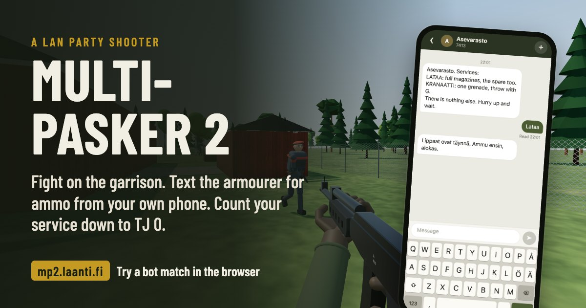

# MULTI-PASKER 2



**A LAN-party shooter where your ammo comes by text message.** Up to 16 players fight it out on a
Finnish army garrison in their browsers, and the only way to reload is to text a gruff armourer
from your own phone: `LATAA` for full magazines, `KRANAATTI` for a grenade. Typos are shown to
the whole room, dying mid-message puts your unsent text in the kill feed, and each kill takes days
off your service, from alokas at TJ 347 to the reservist's star, with päiväraha to spend in the
Sotku App on red dots, recon drones and mortar strikes. Free-for-all or in pairs.

Players install nothing: a desktop browser and a phone on the same Wi-Fi. To try it alone against
bots, play it at **[mp2.laanti.fi](https://mp2.laanti.fi)**.

## Quick start

1. On the computer that hosts the party, install [Node.js](https://nodejs.org/) 22.12 or newer,
   then in this folder:

   ```bash
   npm install
   npm start
   ```

2. Everyone opens the address it prints, for example `http://192.168.1.23:8088/`, in Chrome or
   Edge on the same network, types a name and joins.
3. A first join starts with a short training on the shooting range: it pairs your phone (scan the
   QR code) and teaches you to text the armoury. Then Esc → **Go to the match**.

The host gets **Match settings** in the Esc menu: rounds, round length, bots, and free-for-all or
pairs.

## More

- [How to play](docs/PLAYING.md): the training, the controls, the phone and the armourer, matches
  and pairs, the service and the Sotku App, the awards.
- [Hosting a LAN party](docs/HOSTING.md): requirements, the address and port, troubleshooting,
  and the web version and its deploy.
- [Development](docs/DEVELOPMENT.md): commands, tuning, sounds and voice lines, the hands, the
  technical overview, tests and performance.
- [The technology choices](docs/STACK.md): the client engine and the server runtime, and why.
